  

### `>_ About Me`

I'm Enrique, a Computer Engineering student at **IFPB**, passionate about technology, data and building great software. Currently working as an **IT Intern at Colégio Panorama**, where I develop automations, analyze data and maintain systems.

  
  
  
  
  
  

<table>
<tr>
<td valign="top" width="55%">

### `>_ What I'm Working On`

- [x] Building fullstack applications
- [x] Exploring data & analytics
- [x] Learning more about systems design

</td>
<td valign="top" width="45%">

### `>_ Interests`

📊 Data 
💻 Software Development 
🎮 Games 
🤖 Technology & AI

</td>
</tr>
</table>

> *"There is no spoon."* 
> — The Matrix

  

