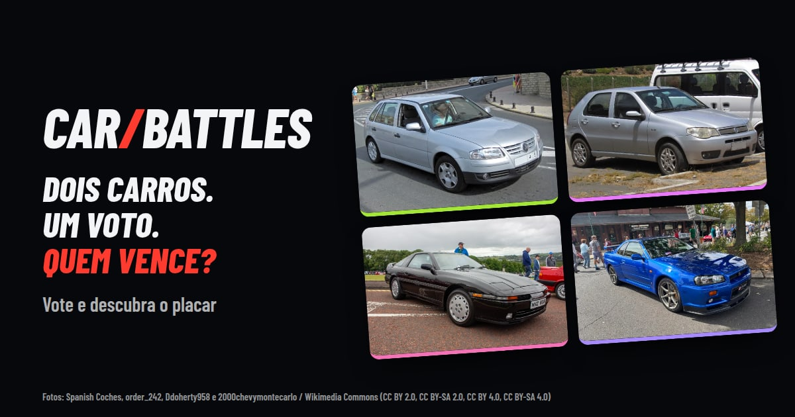

  

### `>_ About Me`

Hi! I'm **Enrique**, a Computer Engineering student at **IFPB** and IT Intern at **Colégio Panorama**, where I build automations, analyze data and maintain internal systems. I'm interested in software development, data and building useful applications — and I keep improving through real, practical projects.

### `>_ Tech Stack`

| | |
|---|---|
| **Languages** |    |
| **Frontend** |     |
| **Backend** |     |
| **Data** |     |
| **DevOps** |       |

### `>_ Featured Projects`

#### [`> Car Battles`](https://car-battles.vercel.app)

Study project: a voting platform where two real cars face off for 4 days and the score is only revealed after you vote. Built end to end and shipped to production, with a fighting-game style 3D "VS" intro, procedurally generated cars and the voting rules enforced in the database.

- **3D:** React Three Fiber scene with cars generated in code from real public dimensions
- **Backend in the database:** Supabase/Postgres with RLS, RPC functions, triggers and pg_cron (one vote per person, hidden score until you vote, scheduling rules)
- **Auth & security:** passwordless login (Google or magic link), captcha, CSP, Vercel firewall, secret scanning, LGPD privacy page
- **Quality & ops:** unit, database and Playwright end-to-end tests in CI, automatic deploy, error tracking (Rollbar), uptime checks (Checkly), hourly watchdog, daily anti-fraud report and encrypted daily backups

`React` `TypeScript` `Three.js` `Tailwind` `Supabase` `PostgreSQL` `Vercel` `GitHub Actions` `Playwright`

[Live demo](https://car-battles.vercel.app)

<table>
<tr>
<td valign="top" width="50%">

#### [`> Nanami`](https://github.com/enriquessribeiro/nanami-site)

Full-stack store with a product catalog, WhatsApp checkout and its own admin dashboard with authentication and image uploads. Includes automated API tests and Docker + Caddy deployment.

`React` `Vite` `Tailwind` `Express` `SQLite` `Docker`

</td>
<td valign="top" width="50%">

#### [`> NaveHub`](https://navehubfe.vercel.app)

Study platform for students with practice questions, essay writing and a performance dashboard. Separate frontend and backend.

`React` `TypeScript` `Supabase` `Express` `Prisma` `PostgreSQL`

[Live demo](https://navehubfe.vercel.app) · [Frontend](https://github.com/enriquessribeiro/navehub_fe) · [Backend](https://github.com/enriquessribeiro/navehub_backend)

</td>
</tr>
<tr>
<td valign="top" width="50%">

#### [`> Quiz-Matematica`](https://github.com/enriquessribeiro/Quiz-Matematica)

Terminal math quiz that loads questions from a CSV file, shuffles them without repetition and validates user input.

`Python` `Pandas`

</td>
<td valign="top" width="50%">

#### `> Coming soon`

A data dashboard: CSV import, data cleaning, an API for metrics and charts with filters — built with public or synthetic data.

`Python` `React` `PostgreSQL`

</td>
</tr>
</table>

<table>
<tr>
<td valign="top" width="55%">

### `>_ What I'm Working On`

- [x] Building full-stack applications
- [x] Exploring data & analytics
- [ ] Learning more about systems design

</td>
<td valign="top" width="45%">

### `>_ Interests`

📊 Data 
💻 Software Development 
🎮 Games 
🤖 Technology & AI

</td>
</tr>
</table>

### `>_ Contact`

<!-- Add your LinkedIn here:

-->

  

  

